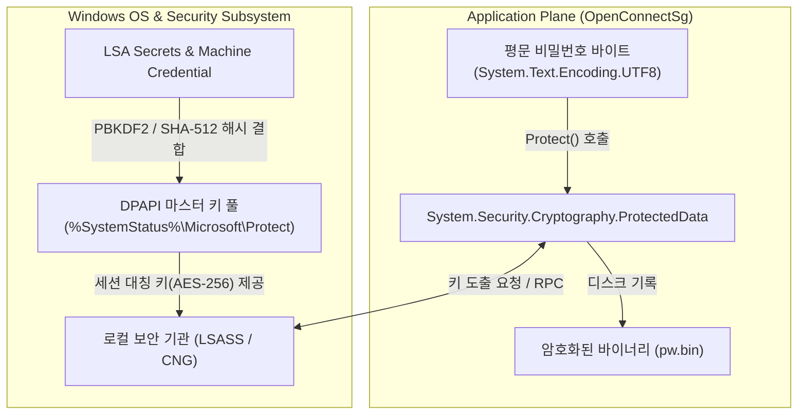

# Windows DPAPI Technical Guide (자격 증명 보안 및 무인 주입 아키텍처)

본 문서는 **OpenConnectSg** 에서 VPN 접속 자격 증명(비밀번호)을 평문 노출 없이 디스크에 안전하게 영속화하고, Windows 백그라운드 서비스(NSSM 데몬) 환경에서 무인증으로 자격 증명을 주입하기 위해 채택한 **Windows DPAPI (Data Protection API)** 의 내부 메커니즘과 보안 공학적 설계 명세를 기술합니다.

---

## 1. Overview & Security Objectives

전통적인 CLI 기반 VPN 클라이언트(OpenConnect, OpenVPN 등)를 자동화할 때 직면하는 가장 고질적인 보안 취약점은 **디스크 상의 평문 비밀번호 저장(Plaintext Credentials at Rest)** 문제입니다.

일반적인 배치 스크립트(`.bat`)나 구성 파일(`.conf`)에 비밀번호를 일반 텍스트로 하드코딩할 경우, 다음과 같은 심각한 보안 위협에 노출됩니다:
1. **인가되지 않은 로컬 사용자의 계정 탈취**: 동일 PC의 다른 사용자나 게스트 계정이 설정 파일 조회 가능.
2. **백업 및 소스 제어 유출**: 스크립트나 로그가 Git 저장소, 백업 드라이브, 클라우드 스토리지에 업로드될 때 자격 증명 누출.
3. **프로세스 모니터링 노출**: 명령줄 인수(`--passwd-on-stdin` 대신 `--password "plain"`)로 전달 시 작업 관리자나 Process Hacker, Sysmon 로깅을 통해 평문 노출.

**OpenConnectSg** 는 별도의 외부 볼트(HashiCorp Vault, CyberArk 등) 에이전트를 설치하지 않고도, Windows 운영체제 커널이 기본 보증하는 **DPAPI (Data Protection API)** 및 **.NET 암호화 서브시스템** 을 활용하여 **"평문 제로(Zero-Plaintext) 보안 모델"** 을 구현했습니다.

---

## 2. Windows DPAPI Architecture & Mechanisms

### 2.1 DPAPI 정의
**DPAPI (Data Protection Application Programming Interface)** 는 Windows 2000부터 도입되어 Windows 11 및 Windows Server 2025에 이르기까지 검증된 Windows 네이티브 대칭 키 암호화 서브시스템입니다.

DPAPI의 가장 큰 공학적 가치는 **키 관리(Key Management)의 운영체제 위임** 에 있습니다:
* 기존 암호화(AES, RSA 등)는 대칭 키를 개발자가 어딘가에 보관해야 하므로 "키를 보호하기 위한 또 다른 키"라는 닭과 달걀의 딜레마(Key Storage Problem)가 발생합니다.
* DPAPI는 Windows OS와 **LSA (Local Security Authority)** 가 로그인 사용자 또는 머신의 고유 하드웨어/OS 비밀값으로부터 암호화 마스터 키를 자동으로 도출(Derive)하므로, 개발자가 키를 직접 관리할 필요가 전혀 없습니다.



---

## 3. Scope Comparison: CurrentUser vs LocalMachine

.NET의 `System.Security.Cryptography.DataProtectionScope` 열거형은 두 가지 보호 범위를 제공합니다.

| 비교 항목 | `DataProtectionScope.CurrentUser` | `DataProtectionScope.LocalMachine` (OpenConnectSg 채택) |
| :--- | :--- | :--- |
| **암호화 바인딩 대상** | 현재 로그인한 Windows 사용자의 계정(SID) | 해당 물리/가상 머신(OS 설치 인스턴스) |
| **마스터 키 저장 경로** | `%APPDATA%\Microsoft\Protect\{User-SID}` | `%SystemRoot%\System32\Microsoft\Protect` |
| **복호화 가능 조건** | 해당 사용자가 대화형 로그온(Logon) 중일 때 | 머신 내 실행되는 프로세스 (권한 제어 필요) |
| **서비스 계정 구동** | 불가 (`NT AUTHORITY\SYSTEM` 세션 복호화 실패) | **완벽 지원** (OS 부팅 즉시 무인 구동 가능) |
| **동일 머신 타인 접근** | 타 사용자는 관리자라 하더라도 직접 복호화 불가 | 동일 PC의 관리자 권한 프로세스는 복호화 가능 |
| **보안 보완책 필요성** | 기본 OS 사용자 분리로 충족 | **NTFS ACL (icacls) 엄격 제한 필수** |

### 3.1 왜 OpenConnectSg는 `LocalMachine`을 채택했는가?
OpenConnectSg는 **NSSM (Non-Sucking Service Manager)** 을 통해 시스템 부팅 시 사용자가 데스크톱에 로그인하지 않아도 VPN 백그라운드 서비스를 자동 시작(`StartType: Automatic`)할 수 있어야 합니다.

* 만약 `CurrentUser` 스코프를 사용하면:
  1. 관리자 콘솔을 닫거나 사용자가 로그오프하는 순간 암호 해독 컨텍스트가 소멸합니다.
  2. 시스템 서비스 계정(`NT AUTHORITY\SYSTEM`)이 데몬 실행 시 `CryptUnprotectData` 실패(`CRYPT_E_NOT_FOUND` / `0x8009000B`) 에러를 발생시킵니다.
* 따라서 무중단 백그라운드 구동을 위해서는 **`LocalMachine`** 스코프 사용이 공학적으로 필수적입니다.

---

## 4. Multi-Layer Defense: NTFS ACL Hardening

`LocalMachine` 스코프는 동일 PC 내의 다른 프로세스에 의한 복호화 가능성이 열려 있다는 본질적 특성을 가집니다. **OpenConnectSg** 는 이를 방어하기 위해 **NTFS ACL (Access Control List) 상속 제거 및 최소 권한 고정** 을 2차 방벽으로 결합했습니다.

### 4.1 권한 격리 구현 명세
비밀번호 암호화 바이너리(`pw.bin`)가 생성되는 즉시, [init-openconnectsg.ps1](file:///c:/Users/SUNGWON/OneDrive/OpenConnectSg/src/init-openconnectsg.ps1)은 Windows 네이티브 `icacls.exe` 엔진을 직접 호출하여 모든 권한 상속을 차단하고 허용 계정을 2개로 강제 격리합니다:

```powershell
# 1. 부모 디렉터리로부터의 모든 ACL 상속 제거 및 기존 권한 일괄 삭제
& icacls "$pwBinPath" /inheritance:r

# 2. 백그라운드 서비스를 실행하는 SYSTEM 계정에만 Full Control 부여
& icacls "$pwBinPath" /grant:r "SYSTEM:(F)"

# 3. 로컬 머신의 최고 관리자 그룹(Administrators, SID: S-1-5-32-544)에만 Full Control 부여
& icacls "$pwBinPath" /grant:r "*S-1-5-32-544:(F)"
```

### 4.2 방어 효과
* **표준 사용자(Standard Users) 차단**: 사내 공용 PC나 다중 사용자 환경에서 일반 사용자가 `pw.bin` 파일을 읽거나 복사하려 시도하면 `0x5 (Access Denied)` 오류로 원천 차단됩니다.
* **악성 소프트웨어 및 랜섬웨어 격리**: 일반 사용자 권한으로 침투한 악성코드가 `pw.bin`을 복호화 시도조차 할 수 없습니다.
* **외부 유출 무력화**: 물리 드라이브를 복제하여 다른 PC나 Linux 환경에서 마운트하더라도, 대상 머신의 DPAPI 마스터 키(LSA Secret)가 없으므로 파일 복호화가 암호학적으로 불가능합니다.

---

## 5. Source Code Implementation Analysis

### 5.1 암호화 파이프라인 ([src/init-openconnectsg.ps1](file:///c:/Users/SUNGWON/OneDrive/OpenConnectSg/src/init-openconnectsg.ps1))
프로필 등록 마법사(`init-openconnectsg.ps1`) 실행 시 사용자 입력을 바이트 배열로 변환하고 메모리 상에서 즉각 DPAPI 암호화를 수행합니다.

```powershell
# UTF-8 바이트 배열 변환
$bytes = [System.Text.Encoding]::UTF8.GetBytes($plainPassword)
$entropy = $null

# DPAPI LocalMachine 암호화 호출
$encrypted = [System.Security.Cryptography.ProtectedData]::Protect(
    $bytes,
    $entropy,
    [System.Security.Cryptography.DataProtectionScope]::LocalMachine
)

# 암호화된 바이너리 디스크 기록
[System.IO.File]::WriteAllBytes($pwBinPath, $encrypted)

# 평문 변수 즉시 덮어쓰기 및 메모리 소멸 유도
$plainPassword = $null
$bytes = $null
[System.GC]::Collect()
```

### 5.2 복호화 및 프로세스 파이프 주입 ([src/openconnectsg.ps1](file:///c:/Users/SUNGWON/OneDrive/OpenConnectSg/src/openconnectsg.ps1))
VPN 데몬이 실행될 때(`service-run` 또는 `connect`), 디스크에 평문 파일을 일절 생성하지 않고 **오직 메모리 스트림 상에서만 복호화한 뒤 `openconnect.exe`의 표준 입력(`stdin`)으로 직접 밀어 넣습니다**.

```powershell
# 1. 암호화된 바이트 로드
$encrypted = [System.IO.File]::ReadAllBytes($pwBinPath)

# 2. DPAPI LocalMachine 복호화
$plainBytes = [System.Security.Cryptography.ProtectedData]::Unprotect(
    $encrypted,
    $null,
    [System.Security.Cryptography.DataProtectionScope]::LocalMachine
)
$plainPw = [System.Text.Encoding]::UTF8.GetString($plainBytes)

# 3. .NET StreamWriter를 통해 openconnect.exe stdin으로 직결 주입
$sw = [System.IO.StreamWriter]::new(
    $proc.StandardInput.BaseStream,
    [System.Text.UTF8Encoding]::new($false)
)
$sw.WriteLine($plainPw)
$sw.Flush()

# 4. 메모리 보안 세척 (Zeroization)
$plainPw = $null
$plainBytes = $null
$encrypted = $null
[System.GC]::Collect()
```

---

## 6. Technical Comparison Matrix

| 비교 기술 | 장점 | 치명적 단점 / 한계 | OpenConnectSg 평가 |
| :--- | :--- | :--- | :--- |
| **평문 구성 파일**<br>(Plaintext .conf) | 구현이 매우 단순함 | 디스크에 비밀번호가 그대로 노출되어 엔터프라이즈 감사 탈락 | **절대 배제** |
| **Windows Credential Manager** | 제어판 인터페이스 제공 | GUI/인터랙티브 사용자 세션 종속적. 무인 Windows 서비스(`SYSTEM`)에서 접근이 까다롭고 신뢰성 결여 | 부적합 |
| **외부 시크릿 볼트**<br>(HashiCorp Vault 등) | 강력한 중앙 통제 및 감사 로그 | 네트워크 의존성(VPN 연결 전에는 사내 볼트 접근 불가 모순 발생), 별도 인프라 비용 | 부적합 |
| **Windows DPAPI**<br>(LocalMachine + ACL) | **Zero-Dependency (OS 내장)**, 오프라인 완벽 구동, 커널 레벨 키 도출, 시스템 서비스 무인 완벽 지원 | 동일 머신 관리자 권한 프로세스에 대한 ACL 보완 필요 | **최적의 아키텍처 (선택)** |

---

## 7. Operational & Troubleshooting Guide

### 7.1 가상 머신(VM) 복제 및 Sysprep 환경 주의사항
* **현상**: VMWare, Hyper-V, VirtualBox 등에서 Golden Image를 복제(Clone)하거나 `sysprep`을 실행한 경우, 새 머신에서 `openconnectsg connect` 실행 시 `CryptUnprotectData` 예외가 발생할 수 있습니다.
* **원인**: Windows SID가 재생성되거나 LSA Machine Secret이 초기화되면서 기존 머신 키와 불일치가 발생하기 때문입니다.
* **해결책**:
  ```powershell
  # 기존 프로필 암호화 재등록
  .\src\init-openconnectsg.ps1
  ```
  단 한 번의 재초기화 마법사 수행으로 새 머신의 DPAPI 키로 즉시 재암호화됩니다.

### 7.2 자격 증명 무결성 검증 명령어
관리자는 다음 원라이너를 통해 `pw.bin`의 암호화 상태와 ACL 보호 상태를 언제든지 검증할 수 있습니다:

```powershell
# ACL 권한 검증 (SYSTEM과 Administrators만 존재하는지 확인)
icacls "C:\Program Files\OpenConnect\profiles\*\pw.bin"

# 정상적인 DPAPI 복호화 가능 여부 자가 진단
Add-Type -AssemblyName System.Security
$sample = Get-ChildItem "C:\Program Files\OpenConnect\profiles\*\pw.bin" | Select-Object -First 1
if ($sample) {
    try {
        $raw = [System.IO.File]::ReadAllBytes($sample.FullName)
        $null = [System.Security.Cryptography.ProtectedData]::Unprotect($raw, $null, [System.Security.Cryptography.DataProtectionScope]::LocalMachine)
        Write-Host "[OK] DPAPI LocalMachine 복호화 정상" -ForegroundColor Green
    } catch {
        Write-Error "[FAIL] 복호화 실패: $_"
    }
}
```
