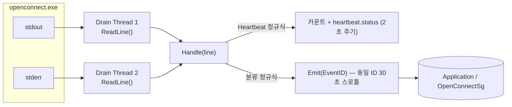
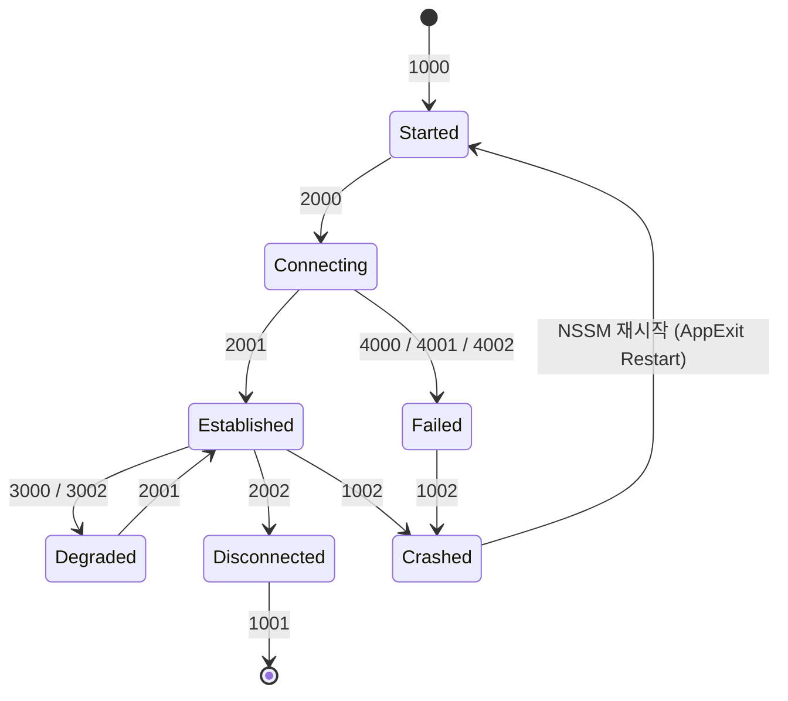

# Windows Event Log (EVTX) Technical Guide

본 문서는 **OpenConnectSg v1.0.5** 의 로깅 아키텍처 — 텍스트 로그 파일(`out.log`, `err.log`)을 폐지하고 **Windows Event Log (EVTX)** 를 단일 신뢰 원천(Single Source of Truth)으로 사용하는 설계 — 의 엔지니어링 근거, 내부 메커니즘, 구현 명세, 운영 방법을 기술합니다. (관련 이슈: [#12](https://github.com/sparklings/openconnectsg/issues/12))

---

## 1. Executive Summary & Architectural Motivation

### 1.1 텍스트 파일 로그의 본질적 한계
| 한계 | 설명 |
|---|---|
| 메타데이터 부재 | 타임스탬프, PID, 심각도, 프로필 식별이 라인에 포함되지 않아 상관 분석이 불가능 |
| 파일 잠금 | NSSM이 파일을 열고 있어 읽기/삭제/로테이션 시 `IOException`, 트레이 GUI의 읽기 충돌 유발 |
| 디스크 오염 | `Unexpected pre-PPP packet header` 같은 하트비트 라인이 `err.log` 를 무한 증가시킴 (이슈 #1) |
| 권한 문제 | `profiles\` 하위 파일은 일반 사용자 권한으로 열람 불가 (Access Denied) |
| 변조 취약성 | 일반 텍스트이므로 로컬 관리자가 임의 수정 가능, 중앙 수집(SIEM) 연계 어려움 |

### 1.2 0바이트 정책
v1.0.5는 VPN 연결·통신·해제·재부팅의 전체 수명주기 동안 `profiles\` 하위에 **어떠한 `*.log` 파일도 생성하지 않습니다.** 대신 `Application` 이벤트 로그에 정형화된 이벤트를 기록하며, Windows 기본 도구(`eventvwr.msc`, `Get-WinEvent`, WEF)를 그대로 활용합니다.

---

## 2. Windows Event Log Architecture & Subsystem

### 2.1 구성 요소
* **WES (Windows Event Subsystem)**: `wevtsvc` 서비스가 채널(`Application`, `System`, ...)별 `.evtx` 파일을 관리합니다. 파일 회전/보존 정책은 채널 설정(`wevtutil gl Application`)에 따릅니다.
* **BinXML**: 이벤트는 디스크에 **BinXML** (XML의 이진 청크 인코딩, 템플릿/치환 방식)으로 저장되어 크기가 작고 조회가 빠릅니다. 조회 시 XML로 *late-binding* 렌더링됩니다.
* **이벤트 소스**: 클래식 소스(`EventLog.CreateEventSource`)는 `HKLM\SYSTEM\CurrentControlSet\Services\EventLog\Application\OpenConnectSg` 키를 만들고 메시지 파일(.NET 내장 `EventLogMessages.dll`)을 연결하여 `%1` 치환으로 본문 문자열을 그대로 표시합니다.

### 2.2 `<System>` Envelope 와 `<EventData>` Payload
모든 이벤트는 다음 공통 메타데이터를 자동으로 갖습니다.

```xml
<Event>
  <System>
    <Provider Name="OpenConnectSg"/>
    <EventID Qualifiers="0">2001</EventID>
    <Level>4</Level>            <!-- 2=Error, 3=Warning, 4=Information -->
    <TimeCreated SystemTime="2026-11-27T00:30:14.890Z"/>
    <Execution ProcessID="12844" ThreadID="0"/>
    <Channel>Application</Channel>
    <Computer>HOST01</Computer>
    <Security UserID="S-1-5-18"/>   <!-- SYSTEM 서비스 -->
  </System>
  <EventData>
    <Data>Profile: openconnect_gw_443_ab12cd34
Server: gw.corp.com:443
VPN tunnel established.
Detail: Connected as 10.20.1.50</Data>
  </EventData>
</Event>
```

OpenConnectSg는 본문의 첫 줄을 항상 `Profile: <서비스명>` 으로 고정하여 프로필 필터링 키로 사용합니다(`Get-OcsEvents`).

### 2.3 ETW vs WES
| 항목 | WES(클래식 Event Log) | ETW(실시간 추적) |
|---|---|---|
| 영속성 | 디스크 `.evtx` 에 보존 | 기본 비영속(세션 버퍼) |
| 용도 | 운영·감사·진단 | 고빈도 성능 추적 |
| 도구 | 이벤트 뷰어, `Get-WinEvent`, WEF | `logman`, `tracerpt`, WPA |
| 본 프로젝트 | **채택** (운영 이벤트가 저빈도) | 미채택 |

---

## 3. OpenConnectSg EVTX Implementation Specification

### 3.1 In-Memory Stream Drainer (데드락 방어)
`openconnect.exe` 의 stdout/stderr 를 파이프로 리다이렉트하면서 **아무도 읽지 않으면** OS 익명 파이프 버퍼(약 4 KB)가 가득 차 자식 프로세스의 쓰기가 영구 블록(Deadlock)됩니다. 이를 막기 위해 `Do-ServiceRun` 은 C# `OpenConnectSg.StreamDrainer` 를 사용합니다.



* 두 스트림을 **각각 전용 백그라운드 스레드**에서 한 줄씩 즉시 소비하므로 버퍼가 고갈되지 않습니다.
* 하트비트(`Unexpected pre-PPP packet header`, `GFtype.heartbeat`, 16진 덤프 라인)는 이벤트로 남기지 않고 **집계만** 수행합니다(상태 파일은 `heartbeat.status` 한 개).
* 의미 있는 라인만 정규식으로 분류하며, 같은 EventID 는 **30초 스로틀**로 중복 기록을 억제합니다.
* `--debug` 모드에서는 동일 드레이너가 원시 라인을 콘솔에도 출력합니다(파일 생성 없음).

### 3.2 EventID Taxonomy

| EventID | 수준 | 발생 위치 | 의미 |
|---|---|---|---|
| 1000 | Information | `Do-ServiceRun` | 서비스(데몬) 시작 |
| 1001 | Information | `Do-ServiceRun` | `openconnect.exe` 정상 종료 |
| 1002 | Error | `Do-ServiceRun` | 비정상 종료(종료 코드 ≠ 0) 또는 러너 예외 |
| 2000 | Information | Drainer | VPN 게이트웨이 연결 시도 |
| 2001 | Information | Drainer | 터널 수립 (`Connected as <IP>`) |
| 2002 | Information | `Stop-TunnelProcess` | 사용자/관리자에 의한 터널 해제 |
| 3000 | Warning | Drainer | DTLS 핸드셰이크 실패 → TLS 폴백 |
| 3001 | Warning | `Do-ServiceRun` | 오류 상태 잔류 Wintun 어댑터 소독 |
| 3002 | Warning | Drainer | 하트비트 간격 > 90초 (Keepalive 지연) |
| 4000 | Error | Drainer | 인증 거부 (`Permission denied`, 401 등) |
| 4001 | Error | Drainer | Wintun 어댑터 생성 실패/타임아웃 (`0x102`) |
| 4002 | Error | Drainer | 방화벽 Brute-force 계정 잠금 |
| 4003 | Error | `Do-ServiceRun` | DPAPI 자격 증명 복호화 실패 |
| 5000 | Information | `init-openconnectsg.ps1` | 마법사 프로필 생성/변경 |
| 5001 | Information | `Do-Upgrade` | 버전 업그레이드 완료 |

분류 우선순위는 `4002 > 4000 > 4001 > 3000 > 2001 > 2000` 입니다(더 구체적인 장애 패턴이 우선).

### 3.3 상태 전이



### 3.4 Legacy Migration
v1.0.4c 이하 설치는 NSSM 이 `AppStdout`/`AppStderr`/`AppRotateFiles`/`AppRotateBytes` 로 파일을 열고 있습니다. `Invoke-LogMigration` 은 다음 시점마다 멱등적으로 레지스트리 값을 제거하고 `logs\` 디렉터리를 삭제합니다: `connect`, `service-run` 시작, `upgrade`. (서비스가 실행 중이면 NSSM 이 파일 핸들을 잡고 있으므로 삭제는 다음 시작 시 완료됩니다.)

---

## 4. Custom View XML Integration

### 4.1 배포 위치
`%ProgramData%\Microsoft\Event Viewer\Views\OpenConnectSg.xml`

```xml
<ViewerConfig>
  <QueryConfig>
    <QueryParams><UserQuery /></QueryParams>
    <QueryNode>
      <Name>OpenConnectSg</Name>
      <Description>OpenConnectSg VPN service events</Description>
      <QueryList>
        <Query Id="0" Path="Application">
          <Select Path="Application">*[System[Provider[@Name='OpenConnectSg']]]</Select>
        </Query>
      </QueryList>
    </QueryNode>
  </QueryConfig>
</ViewerConfig>
```

이벤트 뷰어(`eventvwr.msc`) 좌측 트리의 **사용자 지정 보기 ▸ OpenConnectSg** 로 등록되어, 0-클릭으로 모든 OpenConnectSg 이벤트만 격리 조회됩니다(전체 사용자 공용 뷰).

### 4.2 등록·제거 라이프사이클
| 시점 | 동작 |
|---|---|
| `install-openconnectsg.ps1` | 파일 배포 후 `openconnectsg event-init` 호출 → 소스 + Custom View 등록 |
| `init-openconnectsg.ps1` (setup) | 소스/뷰 등록(멱등) + EventID 5000 기록, NSSM 로그 리다이렉션 제거 |
| `openconnectsg upgrade` | 소스/뷰 재등록(멱등) + EventID 5001 기록 |
| `openconnectsg uninstall` | 소스(`DeleteEventSource`) 및 Custom View XML 영구 삭제 |

### 4.3 원클릭 접근 경로
* **트레이 GUI**: **이벤트 뷰어** 버튼, 트레이 우클릭 메뉴 **이벤트 뷰어 열기** → `eventvwr.msc /v:"…\OpenConnectSg.xml"`
* **CLI**: `openconnectsg logs --gui` (동일 동작), `openconnectsg logs` (터미널 TUI)

---

## 5. Source Code Implementation Deep Dive

| 구성 요소 | 위치 | 역할 |
|---|---|---|
| `Register-OcsEventInfra` / `Unregister-OcsEventInfra` | `src/openconnectsg.ps1` | 이벤트 소스 + Custom View 등록/삭제 |
| `Write-OcsEvent` | 〃 | `Write-EventLog` 래퍼 (본문 첫 줄 `Profile:` 고정, 실패 무시) |
| `Get-OcsEvents` | 〃 | `Get-WinEvent -FilterHashtable` + 프로필 정규식 필터 |
| `Get-OcsRecentIssues` | 〃 | 최근 서비스 시작(1000) 이후의 경고/오류 최대 3건 (`status` 용) |
| `Invoke-LogMigration` | 〃 | 레거시 텍스트 로그 설정 제거 |
| `OpenConnectSg.StreamDrainer` | `Do-ServiceRun` 내 `Add-Type` C# | 인메모리 드레이너, 분류, 하트비트 집계 |
| `Do-Logs` | `src/openconnectsg.ps1` | `logs` 서브커맨드 TUI |
| `Do-Connect --debug` | 〃 | 서비스 중지 후 `Do-ServiceRun -DebugConsole` 직접 실행 |

핵심 호출 패턴(C#):

```csharp
EventLog.WriteEntry("OpenConnectSg", msg, EventLogEntryType.Error, 4000);
```

실패해도 데몬 동작에 영향이 없도록 모든 기록 호출은 `try/catch` 로 감쌉니다(로깅 장애가 VPN 연결을 막지 않음).

---

## 6. Technical Comparison Matrix

| 항목 | 텍스트 파일 로그 | **표준 EVTX (채택)** | ETW 실시간 추적 | RFC 5424 Syslog |
|---|---|---|---|---|
| 구조화/메타데이터 | 없음 | **XML System + EventData** | 있음 | 구조화 데이터(SD) |
| 파일 잠금/회전 관리 | 필요 | **WES 가 관리** | 세션 기반 | 서버 측 |
| 일반 사용자 읽기 | 권한 문제 | **채널 ACL(Event Log Readers)** | 제한적 | 네트워크 |
| 기본 도구 | 메모장 | **이벤트 뷰어/`Get-WinEvent`** | `logman`/WPA | 별도 수집기 |
| 중앙 수집 | 별도 에이전트 | **WEF/SIEM 네이티브** | 어려움 | 네이티브 |
| 영속성 | 파일 | **디스크 .evtx** | 휘발성(기본) | 서버 |

---

## 7. Enterprise Observability & XPath Operations Guide

### 7.1 `Get-WinEvent` 정밀 필터
```powershell
# 최근 24시간 모든 오류
$since = (Get-Date).AddHours(-24)
Get-WinEvent -FilterHashtable @{ LogName='Application'; ProviderName='OpenConnectSg'; Level=2; StartTime=$since }

# 인증 거부/계정 잠금만 (XPath)
Get-WinEvent -LogName Application -FilterXPath "*[System[Provider[@Name='OpenConnectSg'] and (EventID=4000 or EventID=4002)]]"

# 특정 프로필 이벤트 (본문 매칭)
Get-WinEvent -FilterHashtable @{ LogName='Application'; ProviderName='OpenConnectSg' } |
  Where-Object { $_.Message -match '(?m)^Profile:\s*openconnect_gw_443_ab12cd34\s*$' }
```

### 7.2 Windows Event Forwarding (WEF) 구독
수집기(Collector) PC에서 구독을 구성하면 다수 PC의 OpenConnectSg 이벤트를 중앙으로 모을 수 있습니다.
```xml
<QueryList>
  <Query Id="0" Path="Application">
    <Select Path="Application">*[System[Provider[@Name='OpenConnectSg'] and (Level=1 or Level=2 or Level=3)]]</Select>
  </Query>
</QueryList>
```
```powershell
wecutil cs OpenConnectSg-Subscription.xml   # 구독 생성
```

### 7.3 SIEM 연동
* 에이전트(예: Winlogbeat, Splunk UF, Elastic Agent)에서 `Application` 채널의 `provider: OpenConnectSg` 만 수집하도록 필터링합니다.
* 알림 규칙 예: `EventID 4000` 이 5분 내 3회 이상(자격 증명 문제), `EventID 4002`(계정 잠금), `EventID 1002` 반복(데몬 크래시 루프), `EventID 3002`(터널 품질 저하).

### 7.4 보존 정책 점검
```powershell
wevtutil gl Application                        # 최대 크기/보존 방식 확인
wevtutil sl Application /ms:67108864           # 필요 시 최대 크기 64MB 로 조정 (관리자)
```

---

## 8. Verification Checklist (Acceptance Criteria)

1. 연결·통신·해제·재부팅 후 `profiles\` 하위에 `*.log` 가 **0개**인지 확인.
2. 장시간 연결(트래픽 포함) 중에도 데몬이 멈추지 않는지(파이프 버퍼 고갈 없음) 확인.
3. `eventvwr.msc` ▸ 사용자 지정 보기 ▸ **OpenConnectSg** 에서 1000/2001/2002 등 이벤트 조회.
4. 트레이 GUI **이벤트 뷰어** 클릭 시 즉시 이벤트 뷰어 실행.
5. `openconnectsg logs`, `openconnectsg logs --level error`, `openconnectsg connect <profile> --debug` 동작 확인.
