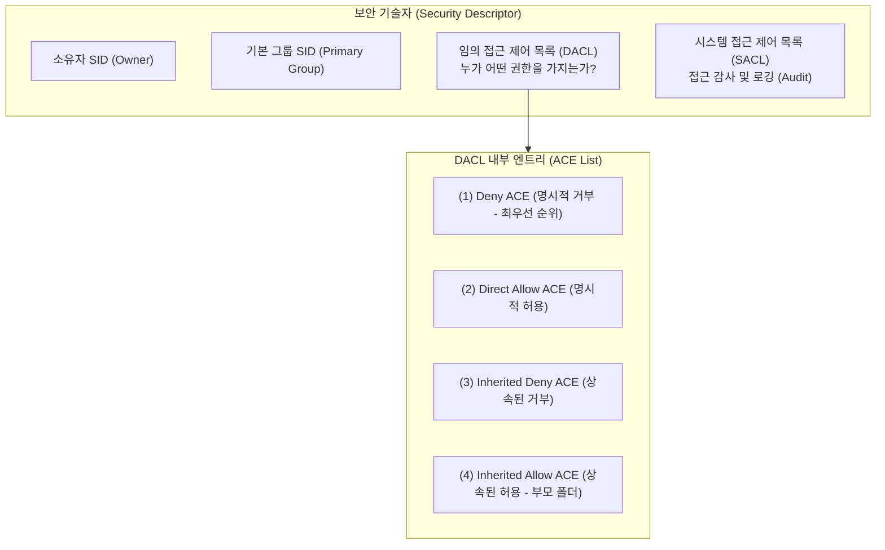
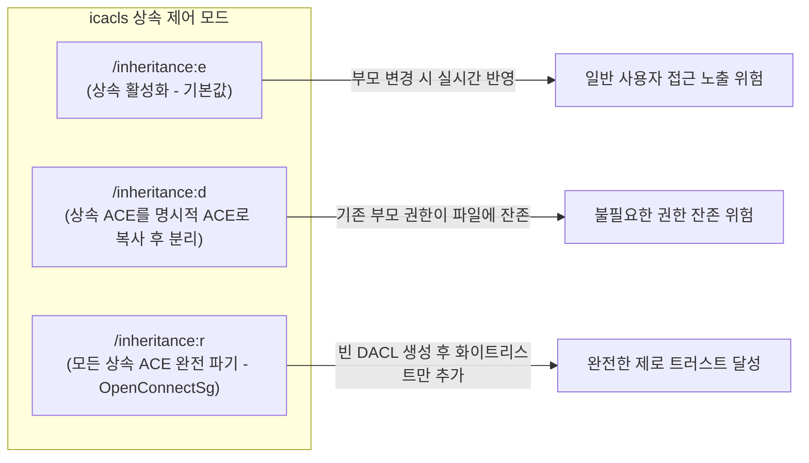
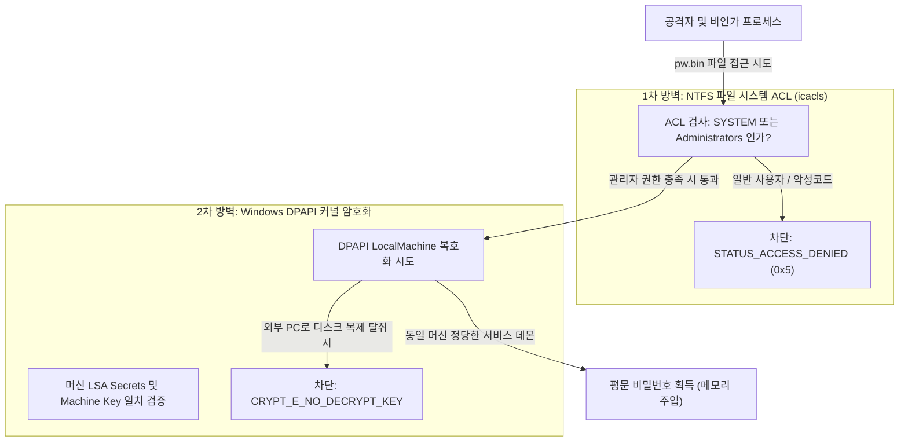

# Windows icacls.exe Engine & NTFS ACL Hardening Technical Guide

본 기술 문서는 **OpenConnectSg** 에서 VPN 접속 자격 증명(`pw.bin`) 및 민감한 프로필 구성을 보호하기 위해 채택한 **Windows 네이티브 `icacls.exe` 엔진과 NTFS 접근 제어 목록(Access Control List, ACL)** 의 내부 보안 아키텍처, 권한 상속 제어, 그리고 언어 독립적 Well-Known SID 하드닝 명세를 기술합니다.

---

## 1. 개요 및 보안 배경 (Executive Summary)

Windows 환경에서 자격 증명을 암호화할 때 **DPAPI (Data Protection API)** 의 `LocalMachine` 스코프를 사용하면 시스템 부팅 시 무인 서비스(`SYSTEM`)로 VPN 터널을 안전하게 자동 구동할 수 있습니다.

그러나 `LocalMachine` 스코프는 **"해당 머신에서 실행되는 모든 프로세스가 이론적으로 복호화 API(`CryptUnprotectData`)를 호출할 수 있다"** 는 고유한 아키텍처 특성을 가집니다. 따라서 다음 조건이 결합되지 않으면 시스템의 보안 경계가 무너질 수 있습니다:
1. **일반 사용자 계정의 파일 탈취**: 동일 PC의 일반 사용자(Standard User)나 게스트 계정이 암호화 파일(`pw.bin`)을 읽거나 복사하여 복호화 시도.
2. **저권한 프로세스 및 악성코드 침투**: 사용자가 실행한 웹 브라우저, 매크로, 일반 권한 악성코드가 디렉터리를 탐색하여 자격 증명 바이트 획득.

**OpenConnectSg** 는 이를 원천 차단하기 위해 **Windows 네이티브 `icacls.exe` 엔진** 을 활용하여 파일 시스템 계층에서 **"권한 상속 즉시 차단(Inheritance Stripping) 및 최소 권한 고정(Least Privilege Pinning)"** 을 2차 방벽으로 결합하는 **다층 방어(Defense-in-Depth)** 를 구축했습니다.

---

## 2. Windows NTFS 보안 서브시스템 및 ACL 아키텍처

### 2.1 보안 기술자(Security Descriptor)의 구조
NTFS 파일 시스템의 모든 파일 및 디렉터리 객체는 Windows 커널의 **보안 기술자(Security Descriptor)** 에 의해 보호됩니다.



### 2.2 SRM (Security Reference Monitor)의 접근 평가 알고리즘
프로세스가 `pw.bin` 파일에 접근(`CreateFile` / `OpenProcess`)을 요청하면, Windows 커널의 **SRM (Security Reference Monitor)** 은 호출자의 액세스 토큰(Token)과 객체의 DACL 내 **ACE(Access Control Entry)** 들을 위에서 아래로 순차 평가합니다:

1. **명시적 거부(Explicit Deny) 우선**: 토큰의 SID가 명시적 거부 ACE에 매칭되면 즉시 `STATUS_ACCESS_DENIED` 반환.
2. **명시적 허용(Explicit Allow) 누적**: 요청한 접근 마스크(예: `FILE_GENERIC_READ`)가 허용 ACE의 합으로 충족되면 즉시 접근 승인.
3. **상속된 ACE 평가**: 명시적 ACE로 결정되지 않은 경우 부모로부터 물려받은 상속 ACE 평가.
4. **묵시적 거부(Implicit Deny)**: DACL의 모든 ACE를 평가한 후에도 요청 권한이 충족되지 않거나 DACL이 비어 있으면 기본 거부.

---

## 3. cacls vs icacls 진화 및 기술 차이

Windows 시스템 관리에서 접근 권한을 제어하는 CLI 도구는 시대에 따라 발전해 왔습니다:

| 비교 항목 | `cacls.exe` (레거시) | `icacls.exe` (현대 표준, OpenConnectSg 채택) |
| :--- | :--- | :--- |
| **도입 시점** | Windows NT 3.51 ~ Windows XP | Windows Vista / Server 2003 SP2 ~ 현재 Windows 11 |
| **무결성 수준(Integrity Level)** | 미지원 | **지원** (MIC: Low, Medium, High, System 제어) |
| **상속 제어 세분화** | 매우 제한적 (상속 강제 덮어쓰기 위험) | **완벽 지원** (`/inheritance:e`, `:d`, `:r`) |
| **Well-Known SID 지원** | 문자열 계정명 위주 (`SYSTEM`, `Administrators`) | **`*SID` 직접 지정 완벽 지원** (`*S-1-5-18`) |
| **ACL 백업 및 복원** | 미지원 | **지원** (`/save`, `/restore` ACL 스냅샷) |
| **비정상 ACL 복구** | 미지원 | **지원** (`/reset`을 통한 기본 상속 ACL 복구) |

---

## 4. icacls.exe 핵심 파라미터 및 권한 마스크 상세 명세

### 4.1 권한 수준(Permission Masks)
`icacls` 에서 지정 가능한 주요 권한 플래그는 다음과 같습니다:

| 플래그 | 명칭 | 세부 파일 시스템 권한 | 보안 영향도 |
| :--- | :--- | :--- | :--- |
| **`(F)`** | **Full Control** | 모든 권한 (읽기, 쓰기, 실행, 삭제, 권한 변경 `WRITE_DAC`, 소유권 이전 `WRITE_OWNER`) | 최고 관리자 전용 권한 |
| **`(M)`** | **Modify** | 읽기, 쓰기, 수정, 실행, 삭제 (`DELETE`) | 일반 편집자 권한 |
| **`(RX)`** | **Read & Execute** | 파일 읽기, 데이터 스트림 읽기, 프로그램 실행 | 실행 바이너리 배포 권한 |
| **`(R)`** | **Read Only** | 파일 데이터 및 속성 읽기 (`FILE_GENERIC_READ`) | 읽기 전용 참조 권한 |
| **`(W)`** | **Write Only** | 데이터 쓰기 및 추가 (`FILE_GENERIC_WRITE`) | 로그 수집기 권한 |
| **`(D)`** | **Delete** | 해당 객체 단독 삭제 권한 | 삭제 전용 권한 |

---

### 4.2 상속 제어 옵션 (`/inheritance`)

Windows에서 파일이 생성되면 기본적으로 **부모 디렉터리(`C:\Program Files\...`)의 DACL을 그대로 상속** 받습니다. 이 경우 부모 폴더에 권한이 있는 모든 계정(예: `Users`, `Authenticated Users`)이 자식 파일에도 접근할 수 있는 치명적인 구멍이 생깁니다.



* **`/inheritance:e`**: 상속을 활성화합니다. (부모 폴더의 권한이 그대로 투과됨)
* **`/inheritance:d`**: 상속을 중단하되, 부모로부터 물려받은 상속 ACE들을 해당 객체의 **명시적(Explicit) ACE로 복사** 하여 남겨둡니다. (기존 일반 사용자 권한이 여전히 남아있을 위험 존재)
* **`/inheritance:r`**: **모든 상속된 ACE를 즉시 완전 제거** 합니다. 파일의 DACL이 완전히 비어 있는 상태(Clean-slate)가 되며, 이후 명시적으로 지정한 계정 외에는 머신의 그 누구도 접근할 수 없게 됩니다.

---

## 5. OpenConnectSg의 Well-Known SID 하드닝 설계

### 5.1 로케일 독립성(Language Agnostic)의 필요성
일반적인 배치 스크립트나 관리자 가이드에서는 다음과 같이 계정 이름을 문자열로 직접 사용합니다:

```cmd
:: 영문 Windows에서만 동작하는 불안정한 방식
icacls "pw.bin" /grant "SYSTEM:F" /grant "Administrators:F"
```

하지만 이 방식은 **다국어(Localized) Windows OS** 환경에서 심각한 장애를 유발합니다:
* **한글 Windows**: `Administrators` 그룹명이 **`관리자`** 로 번역되어 있으므로 `icacls` 가 해당 계정을 찾지 못하고 에러 발생.
* **독일어 Windows**: `Administratoren` 으로 번역됨.
* **프랑스어 Windows**: `Administrateurs` 로 번역됨.

### 5.2 Well-Known SID 문법 (`*SID`) 채택
**OpenConnectSg** 는 운영체제의 언어 설정과 무관하게 전 세계 모든 Windows 10/11 및 Windows Server 환경에서 100% 동일하게 동작하도록 **Well-Known SID 접두사(`*`) 표기법** 을 채택했습니다.

| 계정 / 보안 주체 | 표준 Well-Known SID | `icacls` 표기법 | 역할 및 권한 |
| :--- | :--- | :--- | :--- |
| **`NT AUTHORITY\SYSTEM`** | `S-1-5-18` | **`*S-1-5-18:F`** | NSSM 백그라운드 서비스 데몬이 세션 0에서 실행될 때 파일 복호화 및 로드 |
| **`BUILTIN\Administrators`** | `S-1-5-32-544` | **`*S-1-5-32-544:F`** | 로컬 시스템의 최고 관리자 그룹이 파일 관리, 프로필 수정 및 재초기화 수행 |

---

## 6. 소스 코드 구현 및 실행 메커니즘 분석

### 6.1 프로필 생성 시 원스톱 권한 잠금 ([src/init-openconnectsg.ps1](file:///c:/Users/SUNGWON/OneDrive/OpenConnectSg/src/init-openconnectsg.ps1))
프로필 마법사(`init-openconnectsg.ps1`)의 152번째 라인은 DPAPI로 암호화된 비밀번호 바이너리(`pw.bin`)가 생성되자마자 단 한 줄의 원자적(Atomic) 명령으로 상속 제거와 권한 주입을 완결합니다:

```powershell
# src/init-openconnectsg.ps1 (Line 152)
icacls (Join-Path $dir "pw.bin") /inheritance:r /grant "*S-1-5-18:F" /grant "*S-1-5-32-544:F" | Out-Null
```

#### 세부 동작 과정
1. **`(Join-Path $dir "pw.bin")`**: 대상 프로필 폴더 내의 암호화 바이너리 절대 경로 산출.
2. **`/inheritance:r`**: `Program Files` 부모 디렉터리로부터 물려받은 `Users`, `Authenticated Users`, `ALL APPLICATION PACKAGES` 등의 모든 상속 권한을 단 1ms 만에 완전 파기.
3. **`/grant "*S-1-5-18:F"`**: 머신 로컬 시스템 계정(`SYSTEM`)에 대해 Full Control(`F`) 권한 부여.
4. **`/grant "*S-1-5-32-544:F"`**: 시스템 관리자 그룹(`Administrators`)에 대해 Full Control(`F`) 권한 부여.
5. **`| Out-Null`**: 콘솔 출력 스트림을 억제하여 배치 작업 중 불필요한 표준 출력 노이즈 차단.

---

## 7. DPAPI와의 시너지: 다층 방어(Defense-in-Depth) 매트릭스

DPAPI 암호화와 icacls 파일 접근 제어의 상호 결합은 다음과 같은 전방위 위협 시나리오를 무력화합니다:



| 위협 시나리오 | 단독 DPAPI (`LocalMachine`) | 단독 NTFS ACL | DPAPI + icacls 다층 방어 (OpenConnectSg) |
| :--- | :--- | :--- | :--- |
| **일반 사용자가 `pw.bin` 조회** | 복호화 가능 (위험) | 파일 접근 거부 (차단) | **완벽 차단** (파일 접근 단계에서 차단) |
| **하드디스크 물리 분리 및 복제** | 복호화 불가 (차단) | Linux/WinPE에서 읽힘 (위험) | **완벽 차단** (파일을 복제해도 머신 키 부재로 복호화 불가) |
| **공유 폴더 / 네트워크 유출** | 복호화 불가 (차단) | 네트워크 ACL 누수 위험 | **완벽 차단** (외부 노출되어도 단순 무의미한 바이트열) |
| **로그오프 후 OS 무인 자동 구동** | 정상 복호화 지원 | 정상 권한 지원 | **완벽 지원** (OS 부팅 즉시 데몬 백그라운드 터널 형성) |

---

## 8. 시스템 관리자 감사(Audit) 및 검증 가이드

### 8.1 icacls를 이용한 실시간 권한 감사
관리자는 PowerShell 콘솔에서 다음 명령어를 실행하여 현재 등록된 프로필의 ACL 상태를 직접 확인할 수 있습니다:

```powershell
icacls "C:\Program Files\OpenConnect\profiles\*\pw.bin"
```

#### 정상적인 출력 예시
```text
C:\Program Files\OpenConnect\profiles\openconnect_203.231.7.150_10443_103995b4\pw.bin NT AUTHORITY\SYSTEM:(F)
                                                                                     BUILTIN\Administrators:(F)

Successfully processed 1 files; Failed processing 0 files
```
> [!NOTE]
> 출력 결과에 `NT AUTHORITY\SYSTEM:(F)` 와 `BUILTIN\Administrators:(F)` 외에 다른 계정(예: `Users`, `Everyone`)이 전혀 보이지 않아야 정상입니다.

---

### 8.2 PowerShell .NET 객체를 통한 상세 권한 비트 검증
PowerShell의 `Get-Acl` 및 .NET `AccessRule` 객체를 활용하면 보다 정밀한 프로그래밍 방식의 감사가 가능합니다:

```powershell
$acl = Get-Acl -Path "C:\Program Files\OpenConnect\profiles\*\pw.bin"
Write-Host "상속 차단 여부 (AreAccessRulesProtected):" $acl.AreAccessRulesProtected
foreach ($rule in $acl.Access) {
    [PSCustomObject]@{
        IdentityReference = $rule.IdentityReference.Value
        FileSystemRights  = $rule.FileSystemRights
        AccessControlType = $rule.AccessControlType
        IsInherited       = $rule.IsInherited
    }
} | Format-Table -AutoSize
```

#### 정상 검증 기준
* `AreAccessRulesProtected`: **`True`** (부모 상속이 완전히 차단됨)
* `IsInherited`: **`False`** (모든 룰이 부모로부터 물려받지 않은 명시적 룰임)
* `AccessControlType`: **`Allow`** 만 존재 (SYSTEM 및 Administrators)

---

## 9. 트러블슈팅 및 비상 복구 가이드

### 9.1 권한 손상으로 인한 접근 불가 시 소유권 탈환
관리자 계정의 권한이 실수로 제거되었거나 디렉터리 이동 과정에서 권한이 뒤틀려 `Access Denied` 가 발생할 경우, Windows 내장 `takeown.exe` 도구로 소유권을 강제 탈환한 후 ACL을 재설정할 수 있습니다:

```powershell
# 1. 관리자 권한으로 소유권 강제 탈환
takeown /F "C:\Program Files\OpenConnect\profiles" /R /A /D Y

# 2. 프로필 디렉터리 ACL 초기화
icacls "C:\Program Files\OpenConnect\profiles" /reset /T

# 3. OpenConnectSg 자격 증명 전용 잠금 재적용
Get-ChildItem "C:\Program Files\OpenConnect\profiles\*\pw.bin" | ForEach-Object {
    & icacls $_.FullName /inheritance:r /grant "*S-1-5-18:F" /grant "*S-1-5-32-544:F"
}
```

---

## 10. 결론 (Conclusion)

OpenConnectSg의 `icacls.exe` 엔진 활용은 단순한 파일 숨김을 넘어, **Windows 보안 서브시스템(SRM, DACL, Well-Known SID)의 핵심 원리를 관통하여 설계된 표준 엔터프라이즈 하드닝 모범 사례** 입니다.

* **완전한 상속 차단(`/inheritance:r`)** 을 통해 불필요한 계정의 접근을 근본적으로 제거하고,
* **다국어 불변의 Well-Known SID(`*S-1-5-18`, `*S-1-5-32-544`)** 를 지정하여 글로벌 호환성을 확보하며,
* **DPAPI (`LocalMachine`)** 와의 빈틈없는 다층 방어 구조를 완성함으로써,
Windows PowerShell 사용자에게 상용 VPN 클라이언트 이상의 안전성과 신뢰성을 제공합니다.
