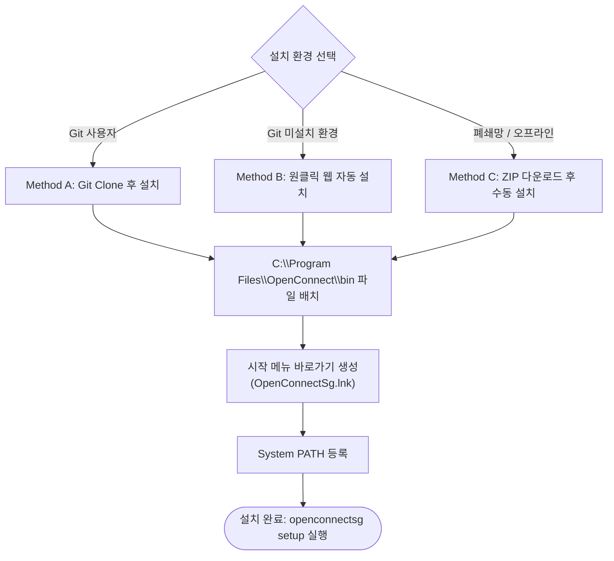
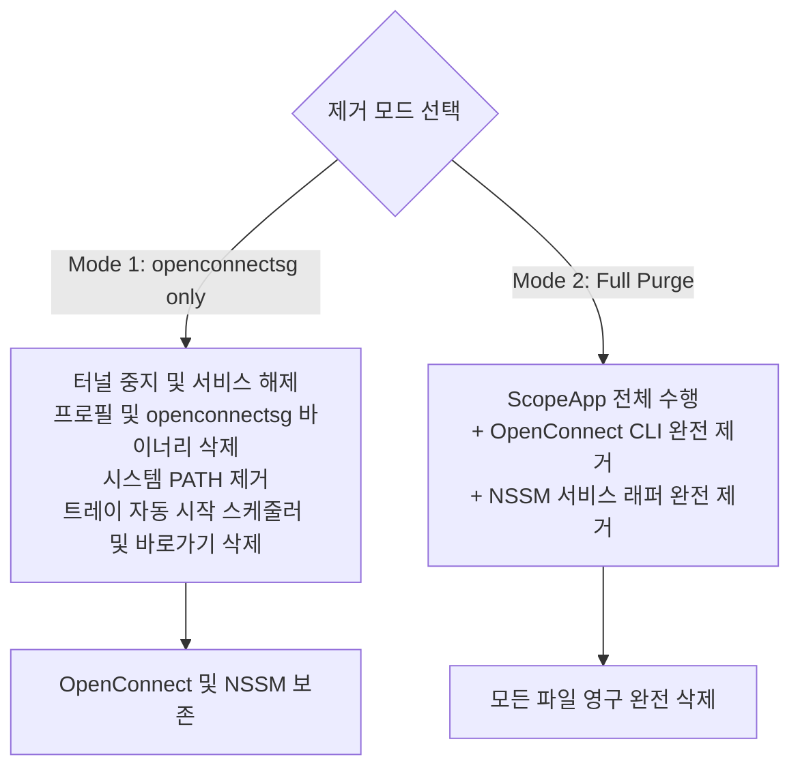

# openconnectsg Installation & Deployment Guide

이 문서는 `openconnectsg`를 Windows 환경에 배포하고 시스템 전역 CLI 및 시스템 트레이 GUI(WinForms), 시작 프로그램(Windows 작업 스케줄러)으로 등록하는 전체 설치 과정과 환경 설정, 유지보수 가이드입니다.

> **관련 문서**: [아키텍처](architecture.md) | [서브커맨드 매뉴얼](subcommand-manual.md) | [보안 및 자격 증명](security-credentials.md) | [트러블슈팅](troubleshooting.md) | [Changelog](../CHANGELOG.md)

---

## 1. System Requirements

설치 전 운영체제 및 실행 환경을 확인하십시오.

| 항목 | 요구 사항 | 비고 |
|---|---|---|
| **운영체제** | Windows 10 / 11 (64-bit) | Windows Server 2016 이상 지원 |
| **PowerShell** | 5.1 이상 | `Windows PowerShell` 기본 탑재 버전 |
| **권한** | 관리자 권한 (Administrator) | 시스템 PATH 등록, 서비스 배치, Wintun 어댑터 제어에 필수 |
| **GUI 프레임워크** | .NET Windows Forms | Windows 기본 탑재 (`System.Windows.Forms`, `System.Drawing`) |
| **도구** | Git (Git 설치 환경 권장) | Git 미설치 환경은 원클릭 웹 설치 및 오프라인 설치 지원 |
| **네트워크** | 인터넷 연결 | NSSM 및 openconnect 의존성 자동 다운로드 및 무결성 검증용 |

---

## 2. Deployed Artifacts Specification

설치 완료 시 시스템에 배치되는 파일 및 시스템 등록 구성 요소 명세입니다:

| 구분 | 경로 / 이름 | 역할 및 설명 |
|---|---|---|
| **CLI Dispatcher** | `C:\Program Files\OpenConnect\bin\openconnectsg.ps1` | 핵심 CLI 엔진, 데몬 제어, 프로필 관리, 프로세스 감시 |
| **PATH Shuttle** | `C:\Program Files\OpenConnect\bin\openconnectsg.cmd` | 어디서나 `openconnectsg` 명령어를 호출할 수 있게 해주는 CMD 셔틀 |
| **Tray GUI** | `C:\Program Files\OpenConnect\bin\openconnectsg-tray.ps1` | WinForms 시스템 트레이 상주 프로그램 및 실시간 라우트 분석기 |
| **Setup Wizard** | `C:\Program Files\OpenConnect\bin\init-openconnectsg.ps1` | 프로필 초기 구성 및 서버 인증서 Pin(RFC7469) 자동 추출 마법사 |
| **Installer** | `C:\Program Files\OpenConnect\bin\install-openconnectsg.ps1` | 시스템 자동 설치, 버전 갱신 및 완전 삭제(Purge) 유틸리티 |
| **Start Menu Shortcut** | `%ProgramData%\Microsoft\Windows\Start Menu\Programs\OpenConnectSg.lnk` | 모든 사용자의 Windows 시작 메뉴에 등록되는 Tray GUI 바로가기 |
| **Logon Scheduled Task** | `OpenConnectSg Tray` (작업 스케줄러) | Windows 사용자 로그인 시 트레이 GUI를 백그라운드 자동 기동 (`RunLevel=Highest`) |
| **System PATH** | Machine Scope `Path` 환경 변수 | `C:\Program Files\OpenConnect\bin` 경로 전역 등록 |

---

## 3. Prerequisites

### 3.1. Run PowerShell as Administrator
설치 스크립트는 시스템 `Program Files` 디렉터리에 접근하고 머신 환경 변수를 수정하므로 반드시 **관리자 권한** 으로 실행해야 합니다.

1. `시작` 메뉴 우클릭 $\rightarrow$ **Windows 터미널(관리자)** 또는 **PowerShell(관리자)** 선택
2. PowerShell 버전 확인:
   ```powershell
   $PSVersionTable.PSVersion
   # Major 버전이 5 이상이어야 합니다.
   ```

### 3.2. Execution Policy
PowerShell 스크립트 실행이 제한된 경우 일시적으로 우회 플래그(`-ExecutionPolicy Bypass`)를 추가하여 실행하거나, 정책을 완화합니다:
```powershell
Set-ExecutionPolicy -ExecutionPolicy RemoteSigned -Scope CurrentUser
```

---

## 4. Installation Methods



### Method A. Clone Repository and Install (Git Environment)

```powershell
# 1) 저장소를 C:\Program Files\OpenConnect\repo 에 clone
git clone https://github.com/sparklings/openconnectsg.git "C:\Program Files\OpenConnect\repo"

# 2) 설치 스크립트 실행 (bin 자동 배치, 트레이 GUI 배포, 시작 메뉴 바로가기 및 PATH 등록)
powershell -ExecutionPolicy Bypass -File "C:\Program Files\OpenConnect\repo\install\install-openconnectsg.ps1"
```

### Method B. One-Line Web Automatic Install (Without Git)

Git이나 개발 도구가 없어도 PowerShell 기본 명령어로 원격 최신 코드를 즉시 내려받아 설치합니다:

```powershell
irm https://raw.githubusercontent.com/sparklings/openconnectsg/main/install/install-openconnectsg.ps1 | iex
```

### Method C. Offline / Manual ZIP Download Installation

1. GitHub에서 [ZIP 다운로드](https://github.com/sparklings/openconnectsg/archive/refs/heads/main.zip) 후 압축 해제
2. 압축 해제한 디렉터리 내에서 관리자 권한으로 실행:
```powershell
powershell -ExecutionPolicy Bypass -File .\install\install-openconnectsg.ps1 -SkipClone
```

---

## 5. Post-Installation & Verification

### 5.1. Welcome Banner

설치가 성공적으로 완료되면 터미널에 다음과 같은 웰컴 배너와 퀵스타트 가이드가 출력됩니다:

```text
   ____                   ______                            __   _____       
  / __ \____  ___  ____  / ____/___  ____  ____  ___  _____/ /_ / ___/____ _ 
 / / / / __ \/ _ \/ __ \/ /   / __ \/ __ \/ __ \/ _ \/ ___/ __/ \__ \/ __ `/ 
/ /_/ / /_/ /  __/ / / / /___/ /_/ / / / / / / /  __/ /__/ /_   ___/ / /_/ /  
\____/ .___/\___/_/ /_/\____/\____/_/ /_/_/ /_/\___/\___/\__/  /____/\__, /   
    /_/                                                             /____/    
 ==============================================================================
  OpenConnectSg :: Windows Background Daemon & DPAPI Automation Wrapper (v1.0.4)
 ==============================================================================
  [DEPLOY]   Target   : C:\Program Files\OpenConnect\bin
  [SYSTEM]   PATH     : Successfully registered (Machine Scope)
  [PACKAGES] Required : OpenConnect CLI v9.21, NSSM v2.24
  [FEATURES] Windows DPAPI Encrypted Credential (pw.bin), Wintun Kernel Tunnel Adapter

 ------------------------------------------------------------------------------
  QUICK START INSTRUCTIONS
 ------------------------------------------------------------------------------
  1. Reload PATH in current session (or open a new terminal):
     $env:Path = [Environment]::GetEnvironmentVariable('Path','Machine') + ';' +
                 [Environment]::GetEnvironmentVariable('Path','User')

  2. Run the interactive setup wizard:
     openconnectsg setup

  3. Connect and verify service status:
     openconnectsg connect
     openconnectsg status

  For all subcommands and syntax: openconnectsg help
 ==============================================================================
```

### 5.2. Command Activation (Important)

Windows는 설치 프로그램(자식 프로세스)이 시스템 PATH를 변경해도 **이미 열려 있는 기존 터미널 세션에는 새 PATH가 자동으로 갱신되지 않습니다**.

* **선택 1 (권장):** **새 PowerShell 창** 을 열면 `openconnectsg` 명령어가 즉시 인식됩니다.
* **선택 2:** 현재 열려 있는 창에서 바로 사용하려면 아래 명령어로 환경 변수를 즉시 다시 로드합니다:
  ```powershell
  $env:Path = [Environment]::GetEnvironmentVariable('Path', 'Machine') + ';' + [Environment]::GetEnvironmentVariable('Path', 'User')
  ```

### 5.3. Verify Installation
```powershell
openconnectsg version
# 출력: openconnectsg 1.0.4
```

### 5.4. Run Initial Profile Setup Wizard
```powershell
openconnectsg setup
```
- 실행 시 필요한 외부 도구(`NSSM 2.24`, `openconnect v9.21`)가 공식 SHA256 체크섬 검증을 거쳐 자동 다운로드 및 설치됩니다. (공식 사이트 장애 시 검증된 GitHub 미러로 자동 대체)
- 원격 VPN 서버의 주소, 포트, 계정, 비밀번호를 순서대로 입력하면 .NET 기반 초고속 인증서 Pin(RFC7469) 추출, Windows DPAPI 암호화 및 서비스 등록이 원스톱으로 완료됩니다.

---

## 6. Windows Tray GUI & Network Route Inspector

`openconnectsg` v1.0.4부터는 터미널을 열지 않고도 작업 표시줄 시스템 트레이에서 VPN 상태를 감시하고 제어할 수 있는 경량 WinForms GUI 애플리케이션(`openconnectsg-tray.ps1`)이 기본 번들로 제공됩니다.

### 6.1. Launching the Tray GUI

트레이 애플리케이션은 아래 두 가지 방법으로 언제든지 기동할 수 있습니다:

1. **CLI 명령어를 통한 백그라운드 기동**:
   ```powershell
   openconnectsg tray
   # 또는 단축 별칭
   openconnectsg gui
   ```
   PowerShell 세션에서 즉시 분리되어 숨김 윈도우 스타일(`-WindowStyle Hidden`)로 트레이 영역에 상주합니다.

2. **Windows 시작 메뉴 바로가기**:
   설치 시 모든 사용자의 시작 메뉴에 등록된 **OpenConnectSg** 아이콘을 클릭합니다:
   - 경로: `%ProgramData%\Microsoft\Windows\Start Menu\Programs\OpenConnectSg.lnk`

> [!TIP]
> **작업 표시줄 트레이 아이콘이 안 보이나요?**  
> Windows 10/11 기본 정책상 새로 실행된 트레이 아이콘은 작업 표시줄 우측의 **숨겨진 아이콘 서랍(`^` 모양)** 안에 배치될 수 있습니다. `^` 버튼을 눌러 자물쇠 모양의 `OpenConnectSg` 아이콘을 확인한 후 작업 표시줄로 드래그하면 상시 노출됩니다.

### 6.2. Tray GUI Features

* **원클릭 터널 제어**:
  - 트레이 아이콘 우클릭 컨텍스트 메뉴에서 등록된 프로필 선택 후 즉시 **Connect** / **Disconnect**.
  - 상태에 따른 트레이 아이콘 동적 툴팁 (예: `OpenConnectSg: Connected (vpn-office)`).
* **Network & Route Inspector (상태 검사기 창)**:
  - 트레이 아이콘 더블 클릭 또는 컨텍스트 메뉴에서 **Status** 선택 시 상세 모니터링 창 노출.
  - 물리 Egress 어댑터(Wi-Fi SSID, 로컬 IP, 기본 게이트웨이) 및 VPN 가상 어댑터(Wintun IP, DNS, MTU) 실시간 표기.
  - Full-Tunnel vs Split-Tunnel 자동 판별.
  - 수신된 라우팅 경로를 사설(Private RFC1918) 및 공인(Public) 대역별로 트리 뷰(Tree View) 그룹화하여 시각화.
  - 창 닫기(`X`) 클릭 시 프로세스가 종료되지 않고 백그라운드 트레이로 안전하게 최소화 (Close-to-Tray).
* **Windows 로그인 시 자동 시작 (Logon Auto-Start)**:
  - 트레이 컨텍스트 메뉴에서 **"Start automatically on Windows logon"** 을 체크합니다.
  - Windows 작업 스케줄러(Task Scheduler)에 `OpenConnectSg Tray` 작업이 최고 권한(`RunLevel=Highest`)으로 등록되어, PC 재부팅 및 윈도우 로그인 시 사용자가 직접 실행하지 않아도 백그라운드 트레이로 자동 실행됩니다.

---

## 7. Update & Upgrade Lifecycle

### 7.1. Automatic CLI Upgrade (`openconnectsg upgrade`)

어느 터미널에서나 아래 명령을 실행하면 최신 GitHub 릴리스 패키지를 자동 다운로드하여 CLI 엔진, 트레이 GUI, 시작 메뉴 바로가기 및 구동 중인 백그라운드 서비스를 일괄 갱신합니다 (UAC 자동 승격):

```powershell
openconnectsg upgrade
```

> [!IMPORTANT]
> **업그레이드 실행 후 트레이 GUI가 자동으로 뜨지 않는 이유**  
> 1. `openconnectsg upgrade`는 **터미널/데몬 레벨의 백그라운드 스크립트 및 서비스 바이너리 갱신 명령** 입니다. 사용자 세션을 방해하지 않도록 대화형 WinForms GUI 창을 강제로 팝업하지 않습니다.
> 2. 기존 버전(v1.0.3c 이하)에서 업그레이드를 수행한 경우, 업그레이드 명령어 자체는 기존 바이너리로 실행되어 신규 트레이 스크립트(`openconnectsg-tray.ps1`)와 시작 메뉴 바로가기(`OpenConnectSg.lnk`)를 파일 시스템에 배포한 후 종료됩니다.
> 3. 따라서 업그레이드 완료 후 트레이 GUI를 사용하려면:
>    - 터미널에서 `openconnectsg tray` 를 실행하거나,
>    - 시작 메뉴에서 **OpenConnectSg** 아이콘을 클릭하십시오.
>    - 이미 이전 버전의 트레이 GUI가 실행 중이었던 경우, 트레이 우클릭 $\rightarrow$ **Exit** 로 기존 GUI를 종료한 후 다시 기동하십시오.

### 7.2. Manual Repository Update (Developer Mode)

```powershell
cd "C:\Program Files\OpenConnect\repo"
git pull --ff-only

powershell -ExecutionPolicy Bypass -File .\install\install-openconnectsg.ps1
```

---

## 8. Uninstall & Complete Purge

설치된 환경을 안전하고 깔끔하게 제거할 수 있는 2가지 방법이 제공됩니다:



### Method A. Interactive CLI Removal (`openconnectsg uninstall`)

관리자 권한 터미널에서 실행:
```powershell
openconnectsg uninstall
```
- **[1] openconnectsg only (권장)**:
  - 실행 중인 터널 중지 및 Windows 서비스 등록 해제
  - 프로필 디렉터리(`C:\Program Files\OpenConnect\profiles`) 삭제
  - 시스템 PATH에서 `bin` 경로 삭제
  - Windows 작업 스케줄러의 `OpenConnectSg Tray` 자동 기동 작업 삭제
  - 시작 메뉴 바로가기(`OpenConnectSg.lnk`) 삭제
  - 배포된 스크립트 바이너리(`bin`) 제거 (OpenConnect CLI 및 NSSM 의존성은 보존)
- **[2] Full Purge**:
  - 위의 1번 작업 전체 수행
  - OpenConnect CLI(`C:\Program Files\OpenConnect\openconnect.exe` 등) 완전 제거
  - NSSM 도구(`C:\Program Files\nssm`) 완전 제거
  - 관련 모든 디렉터리 및 시스템 흔적 완전 영구 파기

### Method B. Removal via Install Script

```powershell
# openconnectsg 및 트레이 바로가기/스케줄러만 제거
powershell -ExecutionPolicy Bypass -File .\install\install-openconnectsg.ps1 -Uninstall -Scope app

# 모든 구성 요소 완전 영구 삭제 (Full Purge)
powershell -ExecutionPolicy Bypass -File .\install\install-openconnectsg.ps1 -Uninstall -Scope full
```

---

## 9. Troubleshooting & FAQ

### Q1. Error: "The script cannot be executed..."
* **원인**: Windows의 PowerShell ExecutionPolicy가 `Restricted`로 설정되어 있습니다.
* **조치**: 실행 시 `-ExecutionPolicy Bypass` 플래그를 붙여 실행하거나 실행 정책을 완화합니다:
  ```powershell
  Set-ExecutionPolicy -ExecutionPolicy RemoteSigned -Scope CurrentUser
  ```

### Q2. Error: "openconnectsg : The term is not recognized as the name of a cmdlet..."
* **원인**: 설치 후 기존 터미널 창을 그대로 사용 중이어서 변경된 PATH 환경 변수가 로드되지 않았습니다.
* **조치**: 현재 터미널 창을 닫고 새 창을 열거나, 다음 명령으로 PATH를 즉시 갱신합니다:
  ```powershell
  $env:Path = [Environment]::GetEnvironmentVariable('Path', 'Machine') + ';' + [Environment]::GetEnvironmentVariable('Path', 'User')
  ```

### Q3. `openconnectsg upgrade` 실행 후 트레이 GUI가 자동으로 나타나지 않습니다.
* **원인**: `upgrade` 명령은 백그라운드 서비스 및 스크립트 파일 배치 유틸리티로, 대화형 데스크톱에 GUI 윈도우를 강제로 팝업하지 않습니다.
* **조치**:
  1. `openconnectsg tray` 명령어를 입력하거나,
  2. Windows 시작 메뉴에서 **OpenConnectSg** 를 클릭하여 실행하십시오.
  3. 부팅 시 항상 트레이에 상주시키려면 트레이 우클릭 메뉴의 **Start automatically on Windows logon** 을 1회 체크해 두십시오.

### Q4. 트레이 프로그램을 실행했는데 작업 표시줄에 아이콘이 보이지 않습니다.
* **원인**: Windows의 기본 작업 표시줄 알림 영역 정책에 따라 새 프로그램 아이콘이 '숨겨진 아이콘 서랍'(`^`)에 숨겨져 있을 수 있습니다.
* **조치**: 작업 표시줄 우측의 `^` 모양 버튼을 누른 후, 자물쇠 모양의 `OpenConnectSg` 아이콘을 작업 표시줄 바깥으로 드래그하여 상시 표시되도록 고정하십시오.

### Q5. Error: "Permission denied" or "Too many bad login attempts"
* **원인**:
  - `Permission denied`: 계정 정보는 유효하나 방화벽 측 SSL-VPN 인가(Authorization) 정책 또는 그룹 권한에 매핑되지 않은 경우입니다.
  - `Too many bad login attempts`: 연속적인 시도로 인해 방화벽의 브루트포스 차단 타이머가 작동한 상태입니다.
* **조치**: 차단 타이머의 경우 3~5분 정도 대기 후 다시 시도하시고, 인가 문제는 네트워크 관리자에게 사용자 계정의 SSL-VPN 접근 그룹 권한을 확인하십시오.
