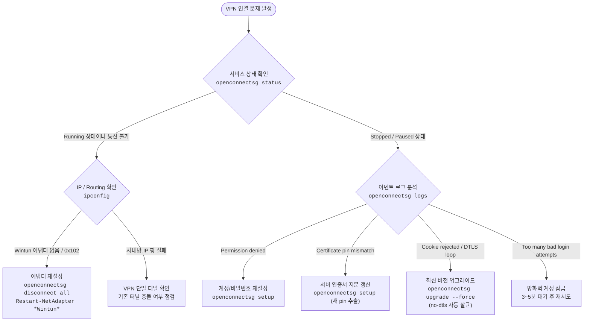

# Troubleshooting & Diagnostic Guide

본 문서는 **OpenConnectSg** 사용 중 발생할 수 있는 주요 네트워크 장애, 프로세스 예외, 인증 실패 및 어댑터 충돌에 대한 원인 분석과 단계별 해결 절차를 안내합니다.

---

## 1. Event Log Locations & Real-Time Diagnostics

v1.0.5부터 텍스트 로그 파일(`out.log`, `err.log`)은 생성되지 않습니다. 연결 문제 발생 시 가장 먼저 확인할 산출물은 **Windows 이벤트 로그** (`Application` 채널, 소스 `OpenConnectSg`) 입니다.

### Event Log Quick Commands
```powershell
openconnectsg logs                       # 최근 15건 (전체 프로필)
openconnectsg logs <profile> --tail 50   # 특정 프로필 최근 50건
openconnectsg logs --level error         # 오류만
openconnectsg logs --raw                 # 이벤트 본문 전체 (Profile/Server/Detail)
openconnectsg logs --gui                 # Windows 이벤트 뷰어 (사용자 지정 보기 ▸ OpenConnectSg)
openconnectsg connect <profile> --debug  # 파일 없이 원시 openconnect 출력을 콘솔에 스트리밍
```

### PowerShell 직접 조회 (XPath)
```powershell
Get-WinEvent -FilterHashtable @{ LogName='Application'; ProviderName='OpenConnectSg'; Level=2 } -MaxEvents 20
Get-WinEvent -LogName Application -FilterXPath "*[System[Provider[@Name='OpenConnectSg'] and (EventID=4000 or EventID=4002)]]"
```

### EventID Quick Reference
| EventID | 의미 | 조치 |
|---|---|---|
| 4000 | 인증 거부 (Permission denied) | `openconnectsg setup` 으로 계정/비밀번호 재설정 |
| 4001 | Wintun 어댑터 타임아웃 (0x102) | `openconnectsg upgrade --force` 후 어댑터 정리 |
| 4002 | 방화벽 계정 잠금 | 3~5분 대기 후 재시도 |
| 4003 | DPAPI 복호화 실패 | 동일 PC/LocalMachine 범위에서 `setup` 재실행 |
| 3000 | DTLS 실패 → TLS 폴백 | 정상 동작 (경고) |
| 1002 | 프로세스 비정상 종료 | 직전 4xxx 이벤트 확인, `--debug` 로 재현 |

---

## 2. Diagnostic & Troubleshooting Workflow



---

## 3. Common Errors, Causes & Remediation

### ① Wintun Adapter Creation Timeout (`0x102` / `CreateTun: Wait failed`)
* **현상**: 이벤트 로그(`openconnectsg logs`)에 `Failed to create Wintun adapter: 0x102` 또는 타임아웃 에러가 발생하며 터널이 형성되지 않음.
* **원인**: 이전 세션에서 생성된 가상 어댑터가 비정상 종료되어 잠겨 있거나, 설정 파일에 특정 인터페이스명이 고정(`interface=...`)되어 충돌한 경우.
* **해결책**:
  1. OpenConnectSg v0.1.2a 이상에서는 자체 소독(sanitize) 및 정리 로직이 내장되어 있습니다. 최신 버전으로 업그레이드합니다:
     ```powershell
     openconnectsg upgrade --force
     ```
  2. 잔존 어댑터 수동 정리:
     ```powershell
     openconnectsg disconnect all
     # 네트워크 어댑터 새로고침
     Get-NetAdapter | Where-Object { $_.InterfaceDescription -like "*Wintun*" } | Restart-NetAdapter
     ```

### ② `Permission denied` or Authentication Rejection
* **현상**: 로그인 단계에서 인증 거부 발생.
* **원인**: 
  - 비밀번호 오입력 또는 사내 포털 비밀번호 만료.
  - 방화벽(FortiGate 등)에서 해당 계정의 SSL-VPN 접근 그룹 권한이 부여되지 않음.
* **해결책**:
  ```powershell
  # 마법사를 통해 계정/비밀번호 갱신
  openconnectsg setup
  ```

### ③ `Too many bad login attempts` (Account Lockout)
* **현상**: 단시간에 여러 번 재연결을 시도하다가 방화벽 차단 정책에 걸림.
* **원인**: 방화벽(Fortinet 등)의 Brute-force 방어 정책에 의해 3~5분간 임시 블랙리스트에 등록됨.
* **해결책**:
  - 즉각적인 재시도를 멈추고 3~5분 대기 후 시도.
  - 비밀번호가 확실하지 않은 경우 마법사 재등록 전 사내 웹 포털에서 먼저 로그인 가능 여부를 확인.

### ④ Server Certificate Pin Mismatch (`signer not found` / `Certificate pin mismatch`)
* **현상**: 방화벽 장비의 인증서가 갱신되거나 재발급되어 연결이 차단됨.
* **해결책**:
  - `profiles\<서비스명>\pin.txt` 파일을 열어 최신 서버 인증서의 RFC 7469 SHA-256 핀으로 수정하거나,
  - `openconnectsg setup`을 재실행하여 신규 인증서 지문을 자동으로 감지하고 재저장.

### ⑤ Conflict with Existing Running VPN Tunnel
* **현상**: 새 프로필로 연결 시도 시 기존 연결과 라우팅 충돌 발생.
* **해결책**:
  - OpenConnectSg는 단일 터널 원칙(Single-Tunnel Policy)을 강제합니다.
  ```powershell
  # 모든 터널 강제 종료
  openconnectsg disconnect all
  # 원하는 프로필로 재연결
  openconnectsg connect 1
  ```

### ⑥ Fortinet SSL-VPN DTLS Failure & Session Cookie Rejection (`Cookie is no longer valid, ending session` / `Cookie was rejected by server; exiting`)
* **현상**: 이벤트 로그(`openconnectsg logs`)에 `svrhello status was "fail" rather than "ok"`, `Failed to connect DTLS tunnel; using HTTPS instead`, `Cookie is no longer valid, ending session`, `Cookie was rejected by server; exiting.`이 반복되며 VPN 연결이 해제됨.
* **원인**: FortiGate 방화벽의 DTLS 핸드셰이크가 실패하고 OpenConnect가 기존 HTTPS(TLS) 터널로 fallback을 시도하지만, FortiGate의 세션 쿠키 단발성 정책(`reconnect-after-drop is not allowed`)으로 인해 이전 쿠키가 거부되어 세션이 파기됨.
* **해결책**:
  - `openconnect.conf`에 `no-dtls` 옵션을 명시하여 불안정한 DTLS 대신 검증된 표준 TLS 터널로만 연결하도록 강제.
  - OpenConnectSg에서는 `openconnectsg connect` 또는 백그라운드 서비스 기동 시 `protocol=fortinet` 설정에 대해 자동으로 `no-dtls`를 살균·보정하여 영구적인 안정 연결을 보장합니다.

---

## 3. Full Reset & Clean Reinstallation (Purge)

복구가 불가능할 정도로 설정이 꼬인 경우 내장 언인스톨러를 통해 시스템을 정리할 수 있습니다.

```powershell
# 1) 도구 스크립트만 삭제 (프로필 및 의존성은 유지)
openconnectsg uninstall -Scope app

# 2) 프로필, 로그, NSSM 서비스 등록을 포함한 전체 완전 삭제
openconnectsg uninstall -Scope full
```
